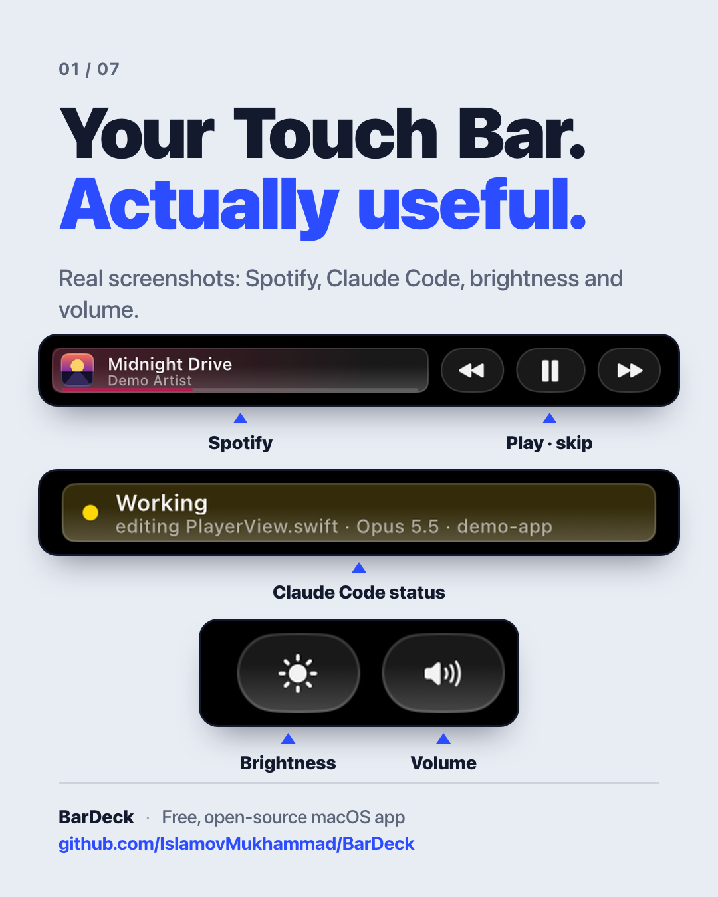
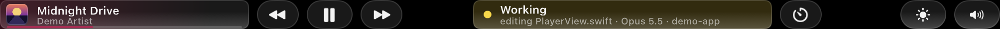
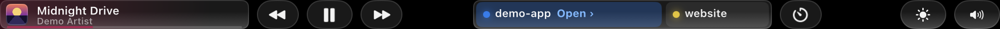
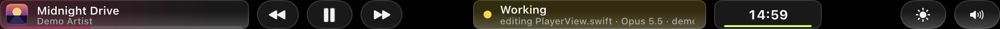
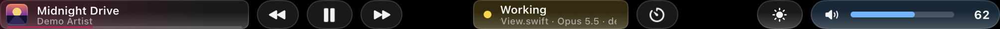
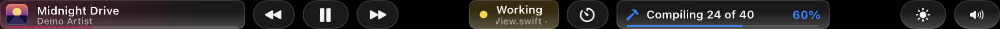
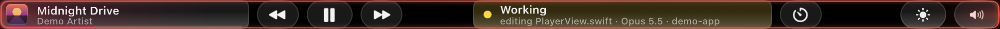
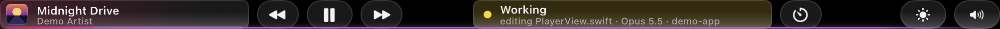
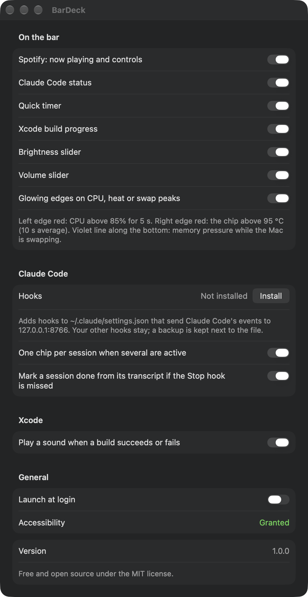

<p align="center">
  
</p>

# BarDeck

[](https://github.com/IslamovMukhammad/BarDeck/actions/workflows/ci.yml)

**Turn your MacBook's Touch Bar into a live deck: Spotify, Claude Code status, a quick timer, sliders, Xcode progress and a health glow.**

A free, open-source menu-bar app that takes over the Touch Bar in every app.

## Features

- **Spotify now playing**: cover art, a scrolling title and artist, a wash in the cover's colour, a progress line, and ⏮ ⏯ ⏭. The skip buttons fold away when nothing is playing.
- **Claude Code status**: Working (with the current tool and file), Needs you, or Done, coloured at a glance. With several sessions open, each one gets its own chip. Tap one to bring that session's window forward.
- **Quick timer**: tap ⏱ to start a countdown right on the bar.
- **Brightness and volume**: sliders that expand when you touch them, and follow changes you make from the keyboard or Control Centre.
- **Xcode progress**: a card shows build and package-fetch progress (for example "Compiling 24 of 40 · 60 %"). It can play a sound when a build succeeds or fails.
- **Health edge glow**: CPU, heat and memory pressure shown as colour around the bar instead of numbers. See [Edge glow](#edge-glow).
- Every item can be turned on or off in Settings. Launch at login.
- Native AppKit + SwiftUI, no third-party dependencies.

## Screenshots

**Music playing, Claude Code working on a file, timer button, brightness and volume**


**Two Claude Code sessions as chips; the blue one needs you (tap Open ›)**


**Quick timer running**


**Volume slider expanded**


**Xcode build in progress**


**Edge glow: CPU (left) and heat (right) in red**


**Edge glow: memory pressure while swapping (violet line along the bottom)**


**Settings**
<p align="center">
  
</p>

All screenshots are real captures of the Touch Bar, taken with demo data.

## Edge glow

BarDeck shows the Mac's health as colour, never as numbers, so the bar stays calm until something is really wrong.

| Colour | Means | Turns on | Turns off |
|---|---|---|---|
| **Red, left edge** | CPU load | CPU above 85 % | CPU below 70 % |
| **Red, right edge** | Heat | Chip temperature above 95 °C (10-second average) | Below 90 °C |
| **Violet line along the bottom** | Memory pressure | Memory pressure is critical, or it is elevated while the Mac swaps more than 5 MB/s | When that is no longer true |

A change must last 5 seconds before the glow turns on or off, so short spikes don't make it flicker.
The temperature is averaged because Apple silicon chips briefly touch high values all the time. The thresholds
are tuned for the M1's hottest sensor. Turn the glow off in **Settings › Glowing edges on CPU, heat or swap peaks**.

## Requirements

- **A Mac with a Touch Bar.** On other Macs, Settings says so and nothing is shown.
- macOS 26 or later
- Accessibility permission, for touches on the bar and to read Xcode's activity text
- Automation permission for Spotify, asked the first time BarDeck talks to it
- Xcode 26 / Swift 6.2 toolchain to build

## Build from source

There is no prebuilt download. Build it yourself in a minute:

```bash
git clone https://github.com/IslamovMukhammad/BarDeck.git
cd BarDeck
./build.sh --install   # builds, copies to /Applications and launches
```

`./build.sh` alone puts the app in `build/BarDeck.app`. Run the tests with `swift test`.
The app icon is drawn in code: `swift Scripts/make_icon.swift` regenerates `Resources/AppIcon.iconset`.

If you have no Apple signing certificate the app is signed ad-hoc; macOS may then ask you to re-grant
Accessibility permission after every rebuild.

## How it works

| Part | File |
|---|---|
| Touch Bar layout and system-wide takeover | `Sources/BarDeck/TouchBar/TouchBarController.swift` |
| Private Touch Bar calls, looked up at runtime | `Sources/BarDeck/TouchBar/PrivateAPI.swift` |
| Spotify via AppleScript | `Sources/BarDeck/Services/SpotifyService.swift` |
| Claude Code hook receiver (private Unix socket) | `Sources/BarDeck/Claude/ClaudeEventServer.swift` |
| Claude Code state machine | `Sources/BarDeck/Claude/ClaudeStatus.swift` |
| Hook installer | `Sources/BarDeck/Claude/ClaudeHooks.swift` |
| CPU / heat / memory gates for the glow | `Sources/BarDeck/System/HealthFeed.swift`, `SMCReader.swift` |
| Brightness and volume | `Sources/BarDeck/Services/SystemBrightness.swift`, `SystemVolume.swift` |
| Xcode progress (read from Xcode's UI text) | `Sources/BarDeck/Xcode/XcodeActivity.swift` |
| Quick timer | `Sources/BarDeck/Timers/QuickTimer.swift` |

### Private APIs

macOS has no public API for showing your own Touch Bar in every app or for display brightness. BarDeck
looks these up at runtime (never linked), and if one is missing it quietly turns that part off instead of crashing:

- `DFRFoundation.framework`: `DFRSystemModalShowsCloseBoxWhenFrontMost`, `DFRElementSetControlStripPresenceForIdentifier`
- Private `NSTouchBar` class methods: `presentSystemModalTouchBar:placement:systemTrayItemIdentifier:`, `dismissSystemModalTouchBar:`, and the system tray item calls (checked with `responds(to:)` first)
- `DisplayServices.framework`: `DisplayServicesGetBrightness` / `DisplayServicesSetBrightness`
- The SMC through IOKit, read-only, for the chip temperature

### Spotify

BarDeck talks to the Spotify desktop app with AppleScript (`tell application "Spotify"`): no Spotify account,
Web API or keys. It only does so while Spotify is already running, so it never launches Spotify by itself. The
first time, macOS asks whether BarDeck may control Spotify (Automation permission). You can change that later in
**System Settings › Privacy & Security › Automation**.

### Claude Code hooks

The Claude card is fed by Claude Code hooks. Nothing is installed until you press **Install** in
**Settings › Claude Code › Hooks**. It then:

1. Creates a random per-install token in `~/Library/Application Support/BarDeck/hook-token` (readable only by you).
2. Writes a small script to `~/Library/Application Support/BarDeck/claude-hook.sh`. In the background, so it
   never slows Claude down or fails a hook, the script sends a few fields of each event to BarDeck's private Unix
   socket, `~/Library/Application Support/BarDeck/claude.sock`, together with the token.
3. Adds one hook per event to `~/.claude/settings.json`: `SessionStart`, `UserPromptSubmit`, `PreToolUse`,
   `PostToolUse`, `SubagentStop`, `Notification`, `Stop`, `StopFailure`, `SessionEnd`. Your other hooks stay
   as they are.
4. Before its first change, saves a backup as `~/.claude/settings.json.bardeck-backup`.

To remove it, press **Remove** in the same place. That deletes BarDeck's hook entries, the script and the token.
You can also delete the entries that run `claude-hook.sh` by hand, or restore the backup.

**What the script sends:** the event name, session id, working folder, transcript path, tool name, a short hint
(the tool's description, a file name without its folder, a web host, a search query, a skill name, or only the
program name of a shell command), and the text of a notification. It never sends your prompts, file contents,
command arguments or tool output.

**Who can talk to BarDeck:** nobody else. There is no network port. The socket sits in a folder only you can
open, and BarDeck drops any request without the right token, with a browser `Origin` header, with a type other
than JSON, or bigger than 1 MB. It only opens transcript files that are regular files inside `~/.claude/projects`.

## Privacy

- Everything stays on your Mac. There is no analytics, telemetry or account.
- Claude Code events travel only from the hook script to BarDeck, over a private Unix socket on your Mac, and only the few fields listed under [Claude Code hooks](#claude-code-hooks). They are kept in memory to draw the card; the model name is read from the end of the session's transcript.
- The only internet request is downloading the current song's cover art from the URL Spotify gives, cached in `~/Library/Caches/BarDeck/artwork`.

## Known limitations

- Only Macs with a Touch Bar. Widths are tuned for the 13-inch Touch Bar.
- Dragging the sliders and tapping the buttons with a finger was not hand-tested for this release. That code is carried over unchanged from the app it came from, where it works.
- Another app that also takes over the Touch Bar will fight BarDeck for it on every app switch. Run one at a time.
- Xcode progress is read from Xcode's UI text, since there is no API, so an Xcode update could break it.
- Heat thresholds are tuned for the M1; other chips may glow earlier or later.
- Transcripts are only read from `~/.claude/projects`. With a custom `CLAUDE_CONFIG_DIR` the card still shows the status, but no model name, and a missed Stop hook isn't recovered.
- English UI only.

Bug reports and pull requests are welcome.

## Credits

Originally built as part of the author's personal desk companion app.

## License

[MIT](LICENSE) © 2026 Muhammad Islamov

## Follow

- GitHub: [@IslamovMukhammad](https://github.com/IslamovMukhammad)
- Telegram: [t.me/infinitwo](https://t.me/infinitwo)
